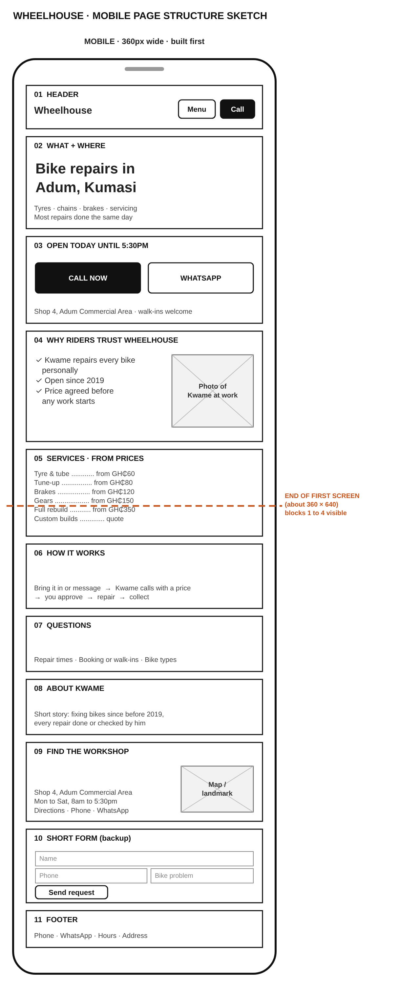

# Wheelhouse Bike Repair: Page Rebuild

**Live page:** https://qcalvin3.github.io/wheelhouse-rebuild/

**Contents:** 1. Understanding the brief · 2. Sketch and structure · 3. Diagnosis · 4. Visual system · 5. Additional improvement · 6. Audit

## 1. Understanding the brief

| Question                                   | Answer                                                                                                                                                                                                           | From the brief                                                                                                                                           |
| ------------------------------------------ | ---------------------------------------------------------------------------------------------------------------------------------------------------------------------------------------------------------------- | -------------------------------------------------------------------------------------------------------------------------------------------------------- |
| Who comes to the page, and on what device? | People near Adum, Kumasi, whose bike has just broken down (a flat, a broken chain, or a bike not serviced in years). They are on their phone, often out and about.                                               | "they search on their phone for a nearby workshop"                                                                                                       |
| What did they come to do?                  | Get the bike fixed today: check the shop can fix their problem, decide if they trust it more than the other shops they are comparing, then call, message or go there.                                            | "They need it fixed today. They look at two or three shops on their phone and pick the one that looks like it knows what it is doing."                   |
| What gets in their way today?              | The current site does not fit a phone screen, the text is small and pale, the phone number and hours are at the very bottom, and the facts that show Kwame is reliable are buried in the FAQ and About sections. | "he suspects his site does not give them enough confidence that he is reliable or professional"                                                          |
| What does the owner need to happen?        | More new customers choosing Wheelhouse over the competitor and getting in touch, with a site that feels trustworthy rather than trendy.                                                                          | "New-customer numbers have been flat while a competitor down the road has been growing." · "He does not want the site to feel trendy for its own sake." |

## 2. Sketch and structure

Kwame's customers arrive on a phone, in a hurry, comparing two or three shops, and they pick the one that "looks like it knows what it is doing". So the first phone screen (blocks 1 to 4, above the dashed line) answers three questions in order: **can this shop fix my problem nearby, can I reach them right now, and can I trust them?** Everything below the line is detail for people who are still deciding.

| #  | Block                           | Why it is here                                                                                                                                                                           | From the brief                                     |
| -- | ------------------------------- | ---------------------------------------------------------------------------------------------------------------------------------------------------------------------------------------- | -------------------------------------------------- |
| 1  | Header with Menu and Call       | Calling is the quickest way for a customer to reach Kwame, so the Call button is always at the top. The menu lets them jump straight to what they need, like prices or directions, without scrolling the whole page on a small screen. I kept the header small so the important information still fits on the first screen.                                                   | "They need it fixed today"                         |
| 2  | What and where                  | As soon as customers open the site, they can see where the shop is, whether it fixes their problem, and that most repairs are done the same day.                                        | "a flat, a broken chain… a nearby workshop"       |
| 3  | Opening hours + Call and WhatsApp | Now they know the shop can fix their problem, the next step is reaching it. The opening hours answer "can they fix it today?", and one tap calls or opens WhatsApp. | "They need it fixed today"                         |
| 4  | Why riders trust Wheelhouse | Real facts from the old site (Kwame repairs every bike personally, open since 2019, price agreed before work) plus a photo of Kwame at work. This is what wins the side-by-side comparison. | "I do good work here. The site does not say that." |
| 5  | Services and from prices        | People compare shops on what they fix and roughly what it costs. Real prices from the old site.                                                                                          | "compare a few shops side by side on their phones" |
| 6  | How it works                    | Bring it in, Kwame calls with a price, you approve, collect. Removes the fear of a surprise bill.                                                                                        | "confidence that he is reliable or professional"   |
| 7  | Questions                       | Remaining doubts (repair times, walk-ins, bike types) for people still deciding.                                                                                                         | "confidence that he is reliable"                   |
| 8  | About Kwame                     | Makes the shop feel personal and real. Detail, so it sits lower.                                                                                                                         | "I do good work here"                              |
| 9  | Find the workshop               | Full address, hours, every contact option and a Google Maps directions link. Adum is busy, so directions help people find the shop.                                                     | "a nearby workshop"                                |
| 10 | Short form (backup)             | For people who prefer to message. One form replaces the two old forms that asked similar things. On a phone, calling is faster, so it is not the main action.                            | "search on their phone"                            |
| 11 | Footer                          | Contact details repeated for anyone who scrolls to the end.                                                                                                                              |                                                    |

**Why only a mobile sketch:** the brief says customers find and compare shops on their phones, often in a hurry, so the phone layout is where Kwame wins or loses them. The built page is still responsive: on wider screens it keeps the same order and lets sections sit side by side.

**What I deliberately left out:** a large photo banner at the top. On a phone it would push the contact buttons and trust points off the first screen, and Kwame wants the site to build trust rather than look trendy.

**Changes made during the build:** block 10 became "Message Kwame in one tap": one-tap WhatsApp messages for common problems (my additional improvement, section 5) plus a single message box that also sends through WhatsApp. This replaced the planned name, phone and problem form, because WhatsApp already gives Kwame the customer's name and number, so he can always reply (the old booking form had no phone field at all). The photo in block 4 is a clearly labelled placeholder until Kwame supplies a real one; using a stock photo of a stranger as "Kwame" would undermine the trust the section is meant to build.

## 3. Diagnosis of the original site

**How I tested:** Chrome DevTools device toolbar at 360 × 640 (a typical phone), the keyboard only (Tab and Enter), the DevTools colour picker for contrast, the Network tab on Slow 4G, and reading `index.html` and `styles.css` line by line. Screenshots are in `docs/evidence/`.

**Ranking:** findings are ordered by how much they cost Kwame new customers, based on the brief: customers are in a hurry, on their phones, comparing two or three shops, and choosing the one that looks reliable. Findings 1 to 8 are broken: they stop customers reading, tapping, finding or trusting something. Finding 9 is dated: the page works, but looks old and inconsistent, which still weakens trust.

### Findings

| # | Symptom | Root cause | Evidence | Who is affected | Why it matters to the business |
|---|---|---|---|---|---|
| 1 | On a phone the whole page appears shrunk; text is tiny and links are too small to tap | No viewport meta tag, so phones render the page at about 980px and scale it down. Behind that, fixed pixel widths (`960px` ×4, plus 280px, 380px and 360px boxes) stop the layout adapting | No `<meta name="viewport">` in `<head>`; `width: 960px` on `#topnav`, `#headerbanner`, `#pagewrap`, `#pagefooter`; `01-fit.png` | Every phone visitor, which per the brief is nearly every customer | Customers comparing shops on their phone see a hard-to-use page and choose the competitor |
| 2 | An urgent customer must scroll past five sections to find the phone number and hours, and then cannot tap to call | The page follows a generic order (services, FAQ, about, booking, contact) rather than what customers need first. Phone and WhatsApp are plain text, not `tel:` or WhatsApp links | "Find Us & Get In Touch" is second to last in the HTML; `<b>Phone:</b> 0322 000 000 `; `01-fit.png`, `02-contact.png` | Every customer who needs a repair today | "They need it fixed today." Every extra step at the moment of contact loses jobs to the competitor |
| 3 | Nothing near the top shows the shop is reliable, and there are no photos at all | The real proof (Kwame repairs every bike personally, open since 2019, same-day repairs, price agreed first) is buried in the About section and inside FAQ answers. The only trust message is an unsupported slogan | Proof sits in "About Wheelhouse" and `.faq-body`; 0 `` elements; `01-fit.png` | Every visitor comparing shops | This is Kwame's exact complaint: "I do good work here. The site does not say that." |
| 4 | A customer can submit a booking that Kwame can never reply to, and gets no confirmation | The booking form has no phone field. Both forms use `<input type="button">`, so nothing is submitted. No `<label>`s; every field is `type="text"`, including email and phone | `index.html` lines 127 to 131 and 164 to 172; 0 `<label>` elements | Anyone who tries to book or message | A customer who thinks they booked but did not is a lost job, and an unhappy one |
| 5 | Text is hard to read, and the prices people compare are faint | Small fixed sizes (11px to 13px), mostly set inline. Each price uses a different decorative colour; 5 of 6 fail contrast | Orange price `#f39c12` on `#fafafa` is 2.1:1 (needs 4.5:1); inline `font-size: 12px`; `05-contrast.png` | Phone users outdoors; people with weaker eyesight | Customers cannot easily read the prices they came to compare |
| 6 | None of the menu links work, and "Pricing" leads nowhere | Every link is `href="#"` and sections have no `id`s to link to. There is no pricing section | `<a href="#"><b>SERVICES</b></a>` and four more | Anyone using the menu, the main shortcut on a phone | A menu that does nothing looks unprofessional, the opposite of "knows what it is doing" |
| 7 | Screen reader and keyboard users cannot jump to sections or open the FAQs, and the page outline is confusing | Built from `
`s with no `header`, `nav`, `main` or `footer`. Headings chosen for size (an `h3` before the `h2`s). FAQ questions are `
`s, so they cannot be focused. No `:focus` styles. `<b>` and ` ` used for styling | 0 landmarks; heading order h1, h3, h2; 42 ` `, 17 `<b>`, 0 lists; 0 `:focus` rules | Screen reader and keyboard users; search engines | An accessible page works for every customer, and a page search engines understand is easier to find |
| 8 | Search results show no description of the shop | No `lang` on `<html>`, no meta description, charset after the title | `index.html` lines 2 to 5 | People finding the shop on Google; screen reader users | Customers find Wheelhouse by searching; a clear description helps it stand out |
| 9 | The page looks patchy and old | No visual system: 18 colour values, 6 font sizes, 21 inline styles. Float-based 960px layout, all-caps nav, copyright 2023 | Six different service card colours; `float: left`; `&copy; 2023`; `09-services.png` | Every visitor | "The current site looks dated, and Kwame thinks that is costing him business." Inconsistency reads as carelessness |

**Tested and not a problem:** page speed. The page is about 10KB with no images or web fonts, so it loads quickly even on Slow 4G. In the rebuild, any photos will be compressed and given `width` and `height` so this stays true.

### The underlying causes

The nine findings come down to five root causes. Fixing these, not each symptom one by one, is the plan for the rebuild:

1. **Built for desktop only.** No viewport tag and fixed pixel widths (findings 1, 5).
2. **Ordered by template, not by customer need.** Contact and trust content buried at the bottom (findings 2, 3).
3. **HTML used for looks, not meaning.** Divs, `<b>`, ` ` and inline styles instead of semantic elements and shared CSS (findings 5, 7, 9).
4. **Left unfinished.** Placeholder links, buttons that do not submit, and a booking form with no phone field (findings 4, 6).
5. **No visual system.** Colours, sizes and spacing chosen one at a time (findings 5, 9).

## 4. Visual system

All colours, sizes and spacing come from CSS custom properties at the top of `css/styles.css`. There are no inline styles and no colours set outside the variables.

| Choice | Value | Why, for Wheelhouse |
|---|---|---|
| Primary colour | `#b93a0b` safety orange | Workshop and hi-vis colours say "trade", so the site looks like a real repair shop. Used only for actions and prices, so the Call button is impossible to miss. White text on it is 5.7:1. Replaces the old site's six different card colours with one |
| Text | `#1c1c1c` charcoal on `#f7f6f3` | 15.8:1 contrast, readable outdoors in sunlight |
| Accent | `#1f4e8c` blue | Used only for the keyboard focus ring, so keyboard users can always see where they are, including on orange buttons |
| Supporting colours | Warm off-white backgrounds and a soft warm band behind the trust section | Calm and plain rather than trendy. Every text pair passes contrast (see the audit) |
| Font | System font | No download, so the page stays fast on mobile data. Clean and familiar |
| Body size | 16px, with 18px for the intro and prices | Readable without zooming (the old site used 11px to 13px) |
| Type scale | 1.2 ratio; headline 28px to 40px with `clamp()` | Headings are clearly different, but the headline never pushes the Call button off the first phone screen |
| Spacing | 4 / 8 / 16 / 24 / 32 / 48 | Tight inside groups, loose between sections, so it is clear what belongs together |
| Tap targets | At least 44px tall | Call and WhatsApp are easy to tap with one thumb |

## 5. Additional improvement: one-tap WhatsApp messages

**The customer problem:** a customer with a broken bike is in a hurry, often standing next to the bike, typing on a phone with one hand. Writing a message from scratch is slow, and vague messages ("my bike has a problem") mean Kwame has to ask questions back before he can help, which wastes time for both of them.

**What I built:** in "Message Kwame in one tap", five buttons for the most common problems (flat tyre, chain, brakes, gears, full service). Tapping one opens WhatsApp with the message already written, for example "Hi Kwame, I have a flat tyre. Can I bring my bike in today?", so the customer only has to press send, and can add a photo. A free-text box below covers anything else, and also sends through WhatsApp.

**What it is worth to Kwame:** contacting the shop drops to two taps, at the exact moment the customer is choosing between shops. Kwame gets clear messages that already say what is wrong and that the customer wants it fixed today, and he always gets their number, so he can reply straight away. The problems listed come from the brief ("a flat, a broken chain, or a bike that has not been serviced in years") and from his real services.

**How it works:** plain HTML links. Each button is a WhatsApp link with the message added to the end (`https://wa.me/233244000001?text=...`), with the text URL-encoded (spaces become `%20`). No JavaScript, so nothing can fail to load, and it works on any phone with WhatsApp.

**Accessible and consistent:** each button is a real link with clear text, at least 44px tall, reachable with the keyboard with a visible focus ring, and styled from the same visual system as the rest of the page.

**Why this and not something bigger:** online booking with payment would add more, but it could not be finished properly in the time, and Kwame's customers already use WhatsApp. One complete improvement that removes effort at the moment of contact is worth more to him than a half-built feature.

## 6. Audit of the rebuilt page

**How I checked:** automated HTML validation (`html-validate`), an automated accessibility check (axe-core) at 360px and 1280px, the W3C Easy Checks by hand (page title, headings, image text, contrast, keyboard focus, 200% zoom, form labels), every colour pair measured for contrast, and a search of the CSS for values that bypass the visual system.

### Results

| Area | Check | Result |
|---|---|---|
| Semantic HTML | Validation | W3C Markup Validation Service: no errors or warnings (after fixing the phone number spacing below) |
| Semantic HTML | Landmarks | `header`, `nav`, `main`, `footer`, plus a labelled `section` for each block |
| Semantic HTML | Heading outline | One `h1`, an `h2` for each section, `h3` for each service. No skipped levels |
| Semantic HTML | Buttons and links | Links go somewhere (sections, `tel:`, WhatsApp, the one-tap messages, maps, email); the form uses a real submit `button`; the menu and questions use `
`. No JavaScript is needed for any of it |
| Accessibility | Automated check (axe-core) | 0 violations at 360px and 1280px |
| Accessibility | Page title | "Wheelhouse Bike Repair \| Adum, Kumasi": says what and where |
| Accessibility | Image text | The one image has alt text that says it is a placeholder |
| Accessibility | Contrast | Every text pair passes 4.5:1, lowest 4.9:1 (the tick marks); body text 15.8:1; orange links, prices and buttons 5.3:1 to 5.7:1 |
| Accessibility | Keyboard | Tab order follows the page: skip link, logo, menu, call, both contact buttons, each question, each contact link, each one-tap message, the form. A visible blue focus ring on every stop |
| Accessibility | Zoom and text resize | At 200% text size, nothing is cut off and there is no sideways scrolling |
| Accessibility | Form labels | The message box has a visible `<label>` |
| Visual consistency | Values from the system | 0 inline styles, 0 colours outside the variables, every font size from the type scale |

### What I fixed, in priority order

1. **Phone numbers could split across two lines** on narrow phones (flagged by the validator 7 times). Fixed with non-breaking spaces. A number broken in half is easy to misread at the exact moment someone is about to call, so this was a quick win with high value.
2. **One font size (18px) and one padding value sat outside the visual system.** Added `--font-size-lead` and used the spacing variable, so every size now comes from the system.

### What I deliberately left, and why

| Left | Why it is not fixed here | Next step |
|---|---|---|
| Real photo of Kwame | High value for trust, but I cannot supply a real photo, and a stock photo of a stranger would be dishonest | Kwame provides a photo; replace the placeholder, keeping `width` and `height` |
| Real phone, WhatsApp and email | The numbers in the brief's starter site are placeholders | Confirm Kwame's real details before going live |
| Exact map pin or landmark | The site only knows "Shop 4, Adum Commercial Area", so the link searches that area | Ask Kwame for a nearby landmark or his exact Google Maps location |
| Menu stays a "Menu" button on desktop | `
` works without JavaScript and suits phones, where most customers are. Showing the links in a row on desktop is low value for this brief | Show the links inline on wide screens in a later JavaScript or CSS pass |
| A live "Open now / Closed" status | It would answer "can I bring it in now?" instantly, but it needs JavaScript, which this course covers in the next module | Add it in the Applied JavaScript module |
| Some fixed pixel values remain | Borders (1px to 3px), the focus ring, icon sizes and maximum widths. These are fine details and layout limits, not text or spacing, so they sit outside the spacing scale on purpose | None needed |

**Overall:** the five root causes from the diagnosis are fixed at the source: the page is built for phones first, ordered by what customers need, written in semantic HTML, finished (every link and button works), and styled from one visual system. What remains needs real information from Kwame rather than more code.
