# Accessibility audit: Wheelhouse Bike Repair site by Emma Ephrim

- Site audited: https://emma-ephrim.github.io/wheelhouse-bike-repair/
- Date tested: 16 November 2026
- Audited by: Calvin Nunana Quashie
- Standard: WCAG 2.2, level AA

## How I tested

- **Automated tools:** WAVE (0 errors, 0 contrast errors, 0 alerts, AIM score 10/10) and Lighthouse (Accessibility 100 on both desktop and mobile). Neither tool flagged any of the findings below. WAVE checks text contrast, but not the borders of form fields. I used these first, then checked everything by hand, and inspected the live page's code with Chrome DevTools.

  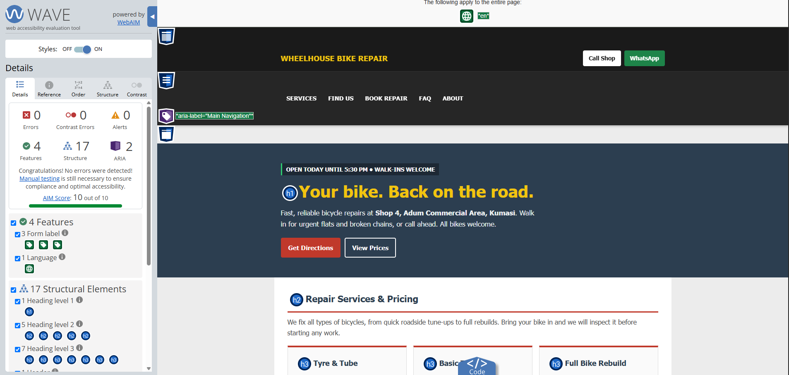
  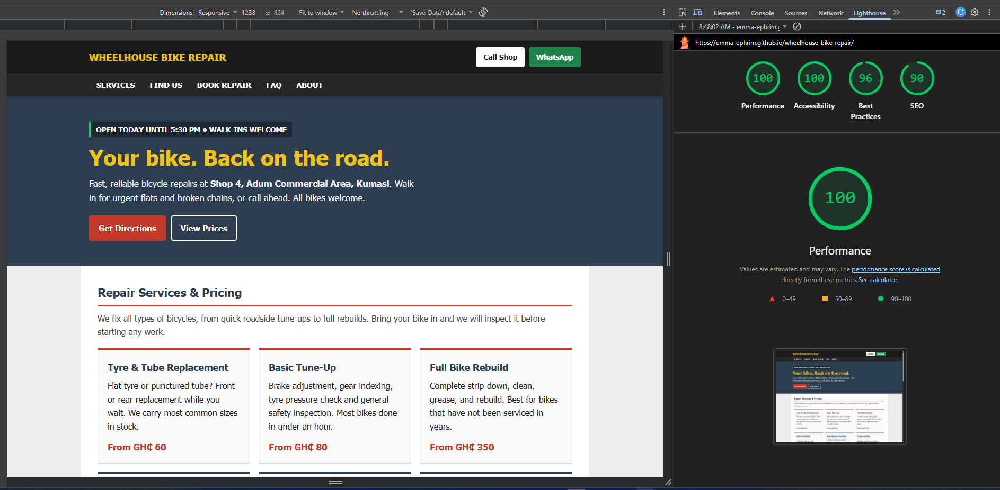
  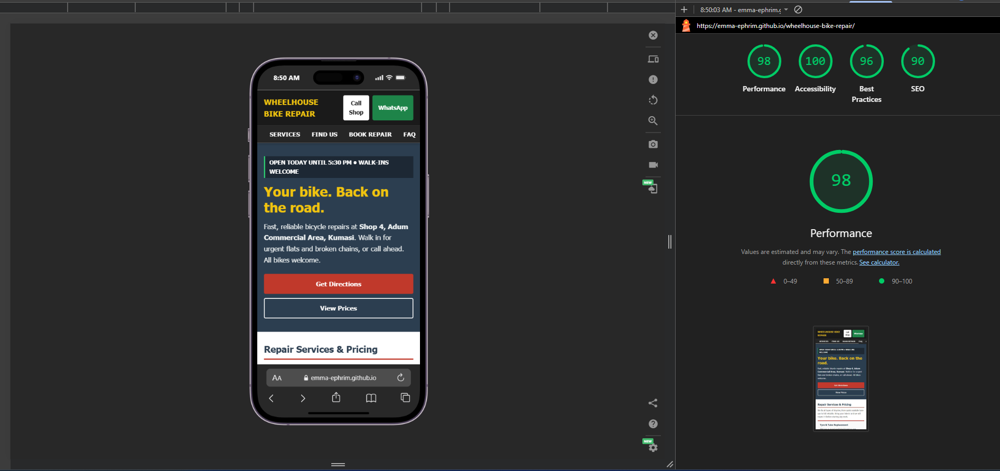
- **Keyboard:** Chrome and Edge on my laptop, mouse unplugged. Journeys: home page to a sent booking request, the menu links, the FAQ, then Tab backwards (Shift+Tab) up the page.
- **Focus visibility:** Chrome, plus Safari on macOS for the header.
- **Zoom, text size and reflow:** Chrome at 200% and 400% zoom, Chrome DevTools at 320px wide, and Chrome's font size set to Very large.
- **Screen reader:** Windows Narrator with Chrome, and VoiceOver with Safari on macOS, on the services, the form and the page structure.
- **Phone:** my iPhone in Safari, one thumb only: the whole page, the header buttons and the booking form.
- **Pages and journeys covered:** the whole single page, with most time on the booking journey because that is where Kwame's customer got stuck.

## Summary

Kwame’s customer could not book a repair one-handed or with only a keyboard. I tested that same journey on this version of the rebuilt site and found barriers that would stop him. The biggest is that the booking form does not work for anyone: pressing Submit Request on the live site shows a blank “405 Not Allowed” page, and the request never reaches Kwame. Keyboard users also lose track of where they are, because the sticky header hides the Submit button when they tab back up the page, and Safari’s focus ring is almost invisible on the dark header. A lot already works well: the page structure is clear, every field has a proper label, Narrator read the page correctly, and the site was comfortable to use with one thumb.

## Findings, in priority order

### 1. Nobody can send a booking request: Submit shows a "405 Not Allowed" error

- **Where:** Book a Service or Ask About Parts section, the **Submit Request** button.
- **What happens:** after filling in all three fields and pressing Submit Request, the page is replaced by a blank page with "405 Not Allowed" at the top. The details are lost, there is no confirmation, and Kwame never receives the request.
- **How to reproduce:**
  1. Open the live site.
  2. Go to Book a Service (or press the Book Repair menu link).
  3. Fill in Your Name, Phone or WhatsApp Number and What does your bike need?
  4. Press Submit Request.
- **Evidence:** the screenshot below shows the 405 page. In the page source (DevTools), the form uses `method="post"` with `action="#booking"`. GitHub Pages only serves static files and does not accept POST requests, which is likely why it returns 405. No script handles the form, and the confirmation area `#booking-list` stays empty.
  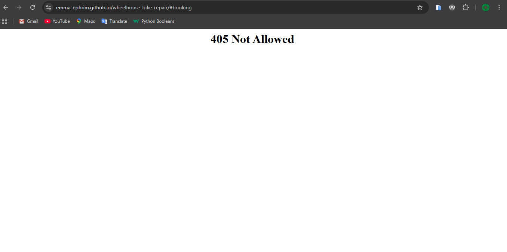
- **Principle and criterion:** Understandable: the site does something the person cannot predict and gives them no feedback. This is a broken feature more than a single WCAG criterion, so I have not attached a criterion number to it.
- **Who it affects and how:** everyone who tries to book online. It hits Kwame's customer hardest: he typed his details one-handed, which is slow and tiring, and then lost all of it. A stranger in his position would leave and book with another shop, and Kwame would never know.
- **Found by:** manual test on the live site; cause checked in the page source with DevTools.
- **Why it ranks here:** it blocks the main task of the site for every visitor, and it matches exactly what the customer described.

### 2. Keyboard users lose sight of the Submit button behind the sticky header

- **Where:** booking form, the Submit Request button, when moving backwards with Shift+Tab. Also after using the Book Repair menu link.
- **What happens:** when I tab down past the form to the FAQ and then press Shift+Tab to go back up, the focused Submit Request button ends up completely hidden behind the sticky header. I can't see where I am. After pressing the Book Repair menu link, the section heading also sits under the header.
- **How to reproduce:**
  1. On a laptop, press Tab until focus reaches the last FAQ question.
  2. Press Shift+Tab slowly, back towards the form.
  3. Watch the Submit Request button as it gets focus. It is hidden behind the header.
- **Evidence:** screenshot below. In DevTools at a 1280×800 window, the focused button sits 0 to 41px from the top while the sticky header is 105px tall. On a 360×640 phone view it sits at 71 to 112px under a 126px header. DevTools shows `position: sticky` on `.site-header` but no `scroll-padding-top` to keep focused items clear of it.
  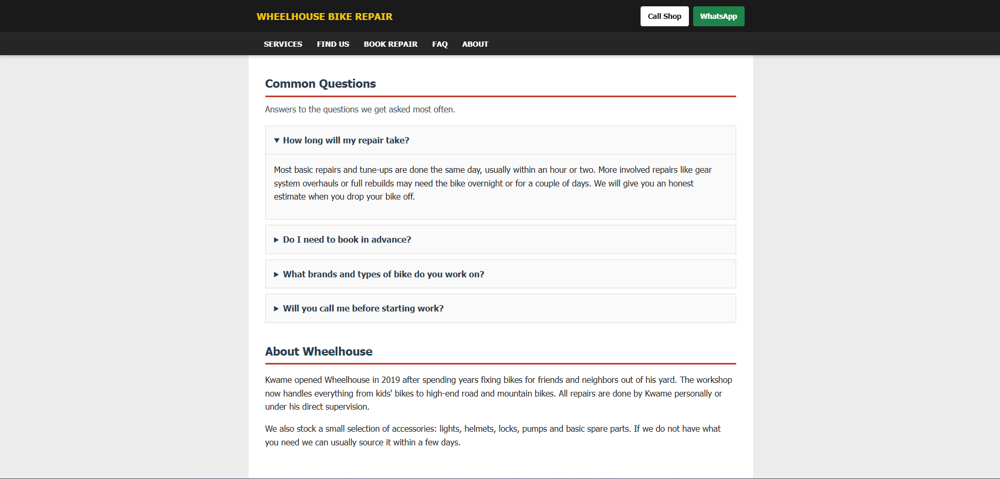
- **Principle and criterion:** Operable; 2.4.11 Focus Not Obscured (Minimum), level AA (new in WCAG 2.2).
- **Who it affects and how:** keyboard users, including Kwame's customer on his laptop. They lose track of focus on the exact button they need to finish booking, and may press Enter without knowing what is selected.
- **Found by:** keyboard test in Chrome.
- **Why it ranks here:** it hits the brief's customer at the most important moment of the booking journey. It is below finding 1 because it only happens when moving backwards, and the form fails anyway.

### 3. The focus ring is almost invisible on the dark header in Safari

- **Where:** header: the Wheelhouse logo link, Call Shop and WhatsApp.
- **What happens:** in Safari on a Mac, tabbing through the header shows only a thin dark blue ring that blends into the dark background. It is hard to tell which item is selected. Chrome shows its two-tone ring clearly, so the problem depends on the browser.
- **How to reproduce:**
  1. In Safari, turn on Settings → Advanced → "Press Tab to highlight each item on a webpage" (without it, Safari's Tab key skips links).
  2. Open the site and press Tab through the logo, Call Shop and WhatsApp.
- **Evidence:** screenshots below, taken in Safari on macOS (light mode) by pressing Tab. Using Digital Color Meter, Safari's ring is `#164188` and the header is `#1A1A1A`. The WebAIM Contrast Checker gives **1.77:1**; focus indicators need at least 3:1. Against the WhatsApp green `#1e8449` it is about **2.1:1**, which also fails. The site has no `:focus-visible` style of its own, so it relies on each browser's default. The menu links are fine because they turn red on focus. For comparison, Chrome adds a white edge to its ring (17.4:1 on the header), so it passes there, but it is still thin and the buttons themselves don't change when focused.
  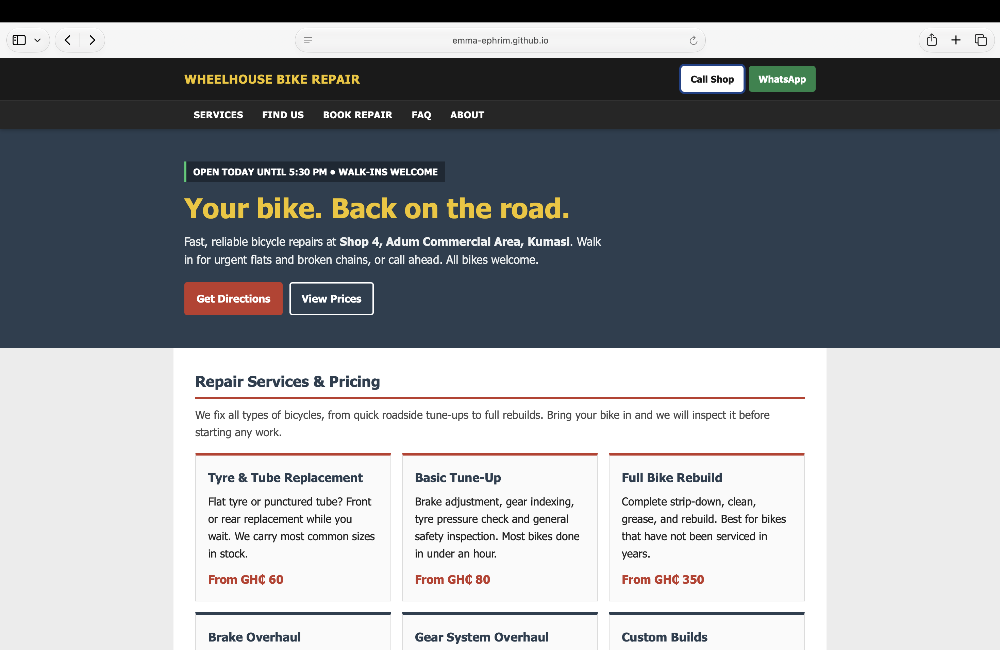
  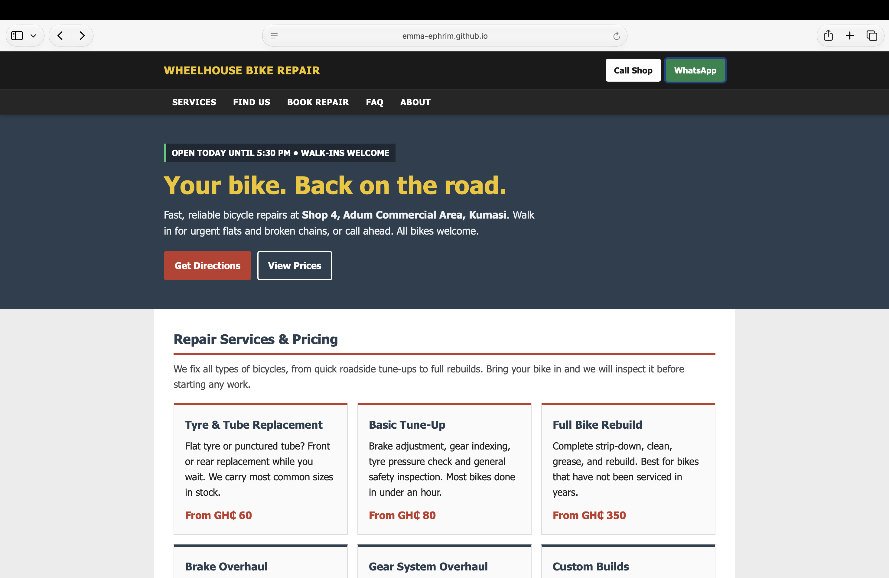
  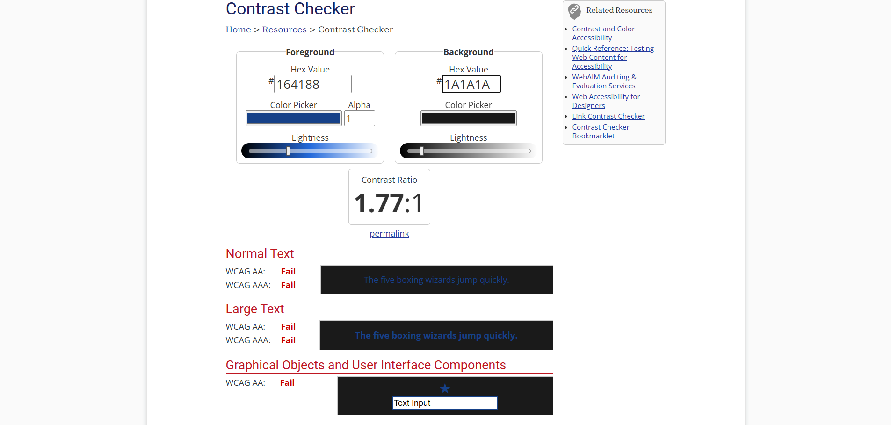
- **Principle and criterion:** Operable; 2.4.7 Focus Visible, level AA, and 1.4.11 Non-text Contrast, level AA.
- **Who it affects and how:** keyboard users on a Mac, like Kwame's customer if he used Safari. The header is the first thing they tab through, so they are lost from the very first key press.
- **Found by:** keyboard test in Safari, compared with Chrome; contrast measured from the screenshot.
- **Why it ranks here:** it affects keyboard users on every visit, but only in Safari and only on three items, so it does less damage than finding 2.

### 4. At 400% zoom the header covers half the screen and the menu scrolls sideways

- **Where:** the whole page, because the header is sticky. The menu bar on narrow screens.
- **What happens:** at 400% zoom the sticky header takes up about half of the screen and stays there while scrolling, so the page can only be read through the bottom half. On narrow screens the menu is a sideways-scrolling strip: "FAQ" and "About" start off-screen with no sign that they are there. At 320px wide the WhatsApp button also pushes the page 2px sideways.
- **How to reproduce:**
  1. On a laptop, press Ctrl and + until the zoom is 400%, then scroll down the page.
  2. In DevTools, set the width to 320px and look at the menu bar and the right edge of the header.
- **Evidence:** screenshot below: at 400% the header and menu fill the screen and the menu shows a sideways scrollbar. Measured at 320×256 (400% zoom on a 1280×1024 window): header 126px tall out of 256px. The menu links need 483px but the screen is 320px.
  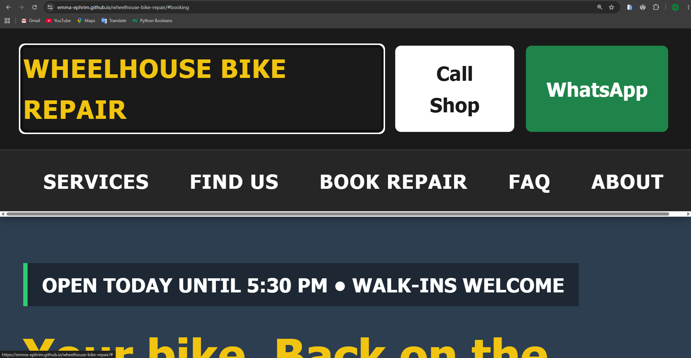
- **Principle and criterion:** Perceivable; 1.4.10 Reflow, level AA.
- **Who it affects and how:** people who zoom to read, such as older customers or anyone with low vision. Half their screen is blocked on every part of the page, and two menu items are hidden from them.
- **Found by:** zoom test in Chrome and DevTools.
- **Why it ranks here:** it makes the whole site hard to use for a large group of people. It sits below findings 1 to 3 because it does not stop the brief's customer from booking.

### 5. The text box borders are too faint to see easily

- **Where:** booking form, the borders of all three fields.
- **What happens:** the light grey borders are hard to see, especially in daylight, so it is not obvious where to tap to type.
- **How to reproduce:**
  1. Look at the booking form on a phone, outdoors if possible.
  2. Check `#999999` against `#ffffff` in the WebAIM Contrast Checker.
- **Evidence:** border `#999999` on the white field measures **2.84:1** in the WebAIM Contrast Checker. The minimum for the edge of a form control is 3:1.
  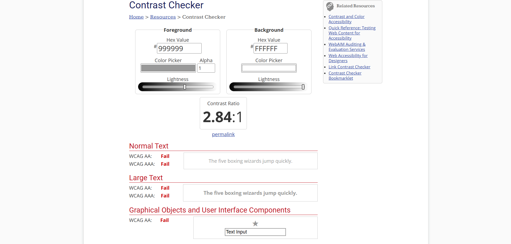
- **Principle and criterion:** Perceivable; 1.4.11 Non-text Contrast, level AA.
- **Who it affects and how:** people with low vision, and anyone using their phone in bright sunlight. They can find the fields from the labels, but it takes longer.
- **Found by:** visual check, measured with the WebAIM Contrast Checker.
- **Why it ranks here:** it is only just under the limit and the labels still point to each field, but everyone has to find the fields, on every device. I rank it just above the autofill finding, which mostly works in practice.

### 6. The form fields don't tell browsers what they are, so autofill depends on guesswork

- **Where:** booking form, Your Name and Phone or WhatsApp Number.
- **What happens:** neither field says what kind of information it wants, so autofill only works if the browser guesses. On my iPhone in Safari, iOS still offered "AutoFill Contact" and my name, because it guessed from the field label and `type="tel"`. Other browsers may not guess, and then a one-handed user has to type everything.
- **How to reproduce:**
  1. On a laptop, right-click Your Name, choose Inspect, and check the `<input>` line. Do the same for the phone field.
  2. Neither has an `autocomplete` attribute.
- **Evidence:** DevTools screenshot below. Neither input has an `autocomplete` attribute (they need `autocomplete="name"` and `autocomplete="tel"`).
  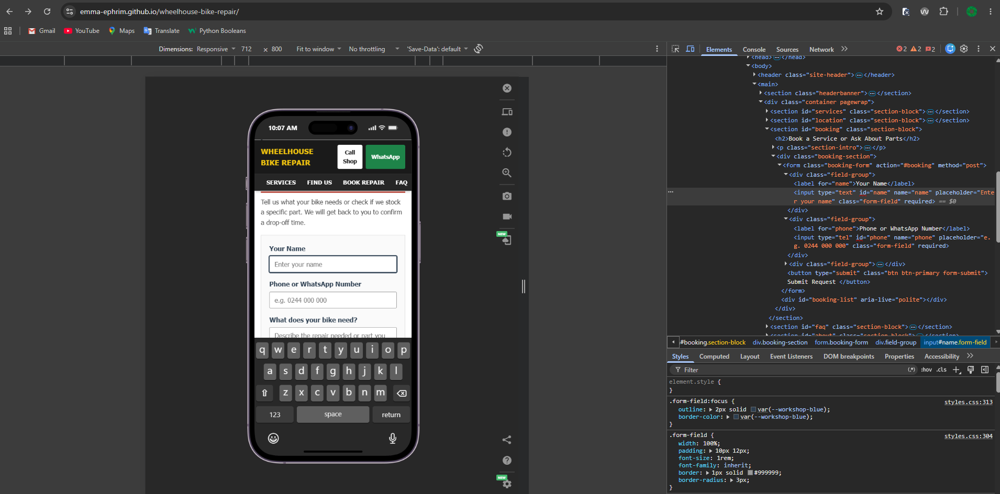
  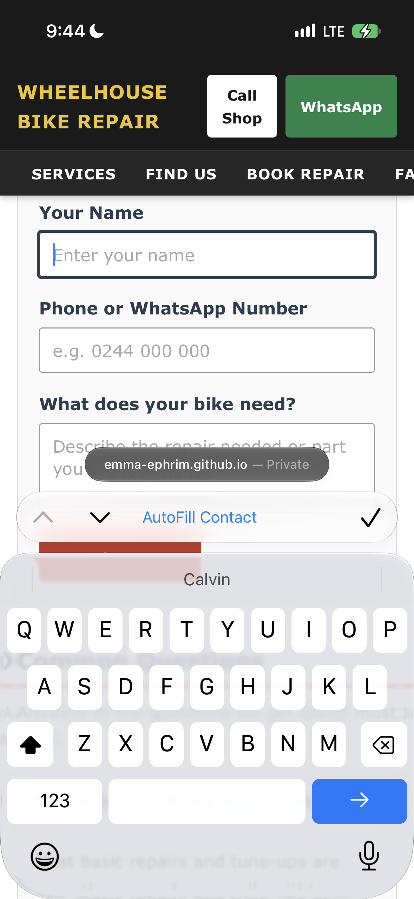
- **Principle and criterion:** Perceivable; 1.3.5 Identify Input Purpose, level AA. The criterion asks for the purpose to be set in the code, not left to the browser's guess.
- **Who it affects and how:** anyone typing with one hand, a tremor or difficulty spelling, including Kwame's customer. When the guess fails, two taps become two fields of typing.
- **Found by:** code check in DevTools; autofill tested on my iPhone (it worked by guessing) and in Chrome's phone view (no suggestions).
- **Why it ranks here:** my own phone still autofilled by guessing, so the real-world impact is smaller than I first expected. It is a clear AA failure, but less likely to stop someone than the faint field borders.

### 7. Nothing shows which fields are required

- **Where:** booking form.
- **What happens:** all three fields are required, but nothing on the screen says so. People only find out when they press Submit and the browser shows a pop-up message.
- **How to reproduce:**
  1. Look at the form: no "required" text or marker.
  2. Leave a field empty and press Submit Request.
- **Evidence:** screenshot below. DevTools shows the fields have the `required` attribute, but there is no visible instruction.
  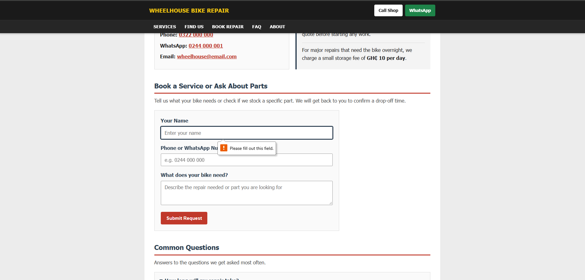
- **Principle and criterion:** Understandable; 3.3.2 Labels or Instructions, level A.
- **Who it affects and how:** everyone, but especially slow typists, such as someone typing one-handed, who only find out after they try to send.
- **Found by:** manual check of the form.
- **Why it ranks here:** the browser still tells people what is missing, so nobody gets stuck. It just costs a little time.

### 8. Recommendation: body text does not grow with the browser's text size setting

- **Where:** paragraph text across the page.
- **What happens:** with Chrome's font size set to Very large, the buttons get bigger but the paragraph text stays the same size, because `body` uses `font-size: 16px` while buttons use `rem`.
- **How to reproduce:** Chrome Settings → Appearance → Font size → Very large, then reload the site.
- **Evidence:** observed directly in Chrome (no screenshot). The `body` rule in DevTools shows `font-size: 16px`.
- **Principle and criterion:** Perceivable; related to 1.4.4 Resize Text, level AA. **This is not a failure:** page zoom still enlarges everything, so 1.4.4 is met. I am listing it as a recommendation only.
- **Who it affects and how:** people who set a larger default text size instead of zooming. They get uneven text sizes.
- **Found by:** text-size test in Chrome.
- **Why it ranks here:** it is not a violation, so it comes last.

## What works well

- **Clear structure:** the page uses header, nav, main and footer landmarks, and the headings go in order (h1, then h2 for each section, then h3 for each service).
- **Screen reader:** with Narrator and VoiceOver both read the page read correctly. Headings, landmarks, links, the form labels and the button were all announced, and each price was read inside its own service card.
- **Form labels:** every field has a real `<label>`, and Submit Request is a real `<button>`.
- **FAQ:** built with `
` and `
`, so it opens and closes with the keyboard.
- **Keyboard shortcut to the form:** keyboard users can reach the booking form quickly with the Book Repair menu link (6 Tab presses and Enter, then Tab into Your Name). Without it, it takes 14 Tab presses from the address bar. There is no skip link, but the menu link and the `<main>` landmark mean this is not a failure. A "Skip to main content" link would still be a nice small improvement.
- **One-handed phone use:** the buttons and links were comfortable to tap with one thumb. The header buttons are about 60px tall, well above the 24px minimum.
- **Text contrast:** all the text I checked passed, and zoom is not disabled.

## Not tested, and limits of this audit

- I used Narrator with Chrome and VoiceOver with Safari on macOS. I did not test NVDA, TalkBack or VoiceOver on iPhone.
- Phone testing was on one device, my iPhone, in Safari only. I did not test an Android phone.
- I did not test dark mode or a slow network connection.
- The open/closed sign uses the visitor's own clock, not Kumasi time. That is about accuracy rather than accessibility, so I have left it out of the findings.
