# EE02 lab write-up: fixing my Wheelhouse site

- **Live site:** https://qcalvin3.github.io/wheelhouse-rebuild/
- **Audit of my site, by Emmanuel Ephrim:** [audit-of-qcalvin3.md](https://github.com/emma-ephrim/wheelhouse-bike-repair/blob/master/docs/ee02/audit-of-qcalvin3.md)
- **My audit of Emmanuel's site:** [audit-of-emma-ephrim.md](audit-of-emma-ephrim.md)
- **Standard:** WCAG 2.2, level AA

## Summary

Emmanuel audited my rebuilt Wheelhouse page and found four barriers, all about the sticky header, the menu and focus visibility. I reproduced each one myself, found the cause in my code, fixed it and checked the fix. I then acted on my trainer's review of the first lab: I added photos and icons, showed the menu links directly on desktop, and used the desktop width properly instead of stretching the phone layout. Finally, I added a text message (SMS) option for riders that neither audit thought about: people without WhatsApp or mobile data, and Deaf riders who can't make a call.

After all the changes, Lighthouse scores 100 for accessibility on mobile and desktop, and WAVE reports 0 errors and 0 contrast errors.

## 1. Fixes from Emmanuel's audit

I kept Emmanuel's order, because I agree with his ranking: the first two hide what the user is focused on, the third makes focus hard to see in one place, and the fourth has a workaround (keyboard users can still reach "Find us" with Tab).

Each fix has before and after screenshots in [evidence/fixes-from-emma-audit](evidence/fixes-from-emma-audit/). I verified the fixes in Chrome and Firefox on Windows.

### Fix 1: the sticky header hid focused buttons and covered headings

**Emmanuel's finding:** 2.4.11 Focus Not Obscured (Minimum). Pressing Shift + Tab up the page left the focused button hidden behind the sticky header. Jumping to a section from the menu or the skip link hid the section heading too.

**Reproduced:** At 360 × 640, I clicked in the message box and pressed Shift + Tab three times. Focus landed on "Brakes not working well", and the button was completely behind the header.

**Cause:** The header uses `position: sticky`, so it stays on top of the page. When the browser scrolls a focused element or a jump target into view, it lines it up with the very top of the window, which is exactly where the 60px header sits. The browser didn't know the header was there.

**What changed** (commit `f0ed512`):
- Added `scroll-padding-top` to `html`. It tells the browser to leave a gap at the top whenever it scrolls something into view.
- Stored the header height in one variable, `--header-height`, and used it for both the header's height and the gap, so the two can't drift apart if the header changes later.

**Why this fixes the cause:** The browser now stops scrolling below the header instead of under it, for every focus move and every link jump, without me fixing each link one by one.

**Verified:** I repeated Emmanuel's steps. "Brakes not working well" now shows fully below the header with its focus ring. Menu links and the skip link land with the heading visible.

| Before | After |
|---|---|
| 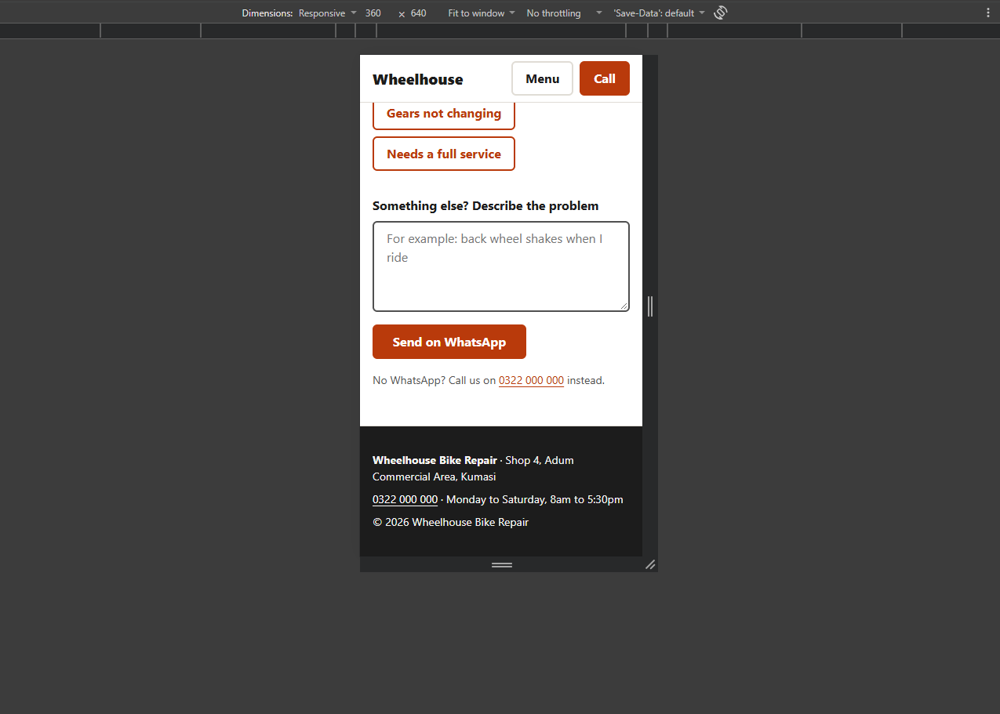 | 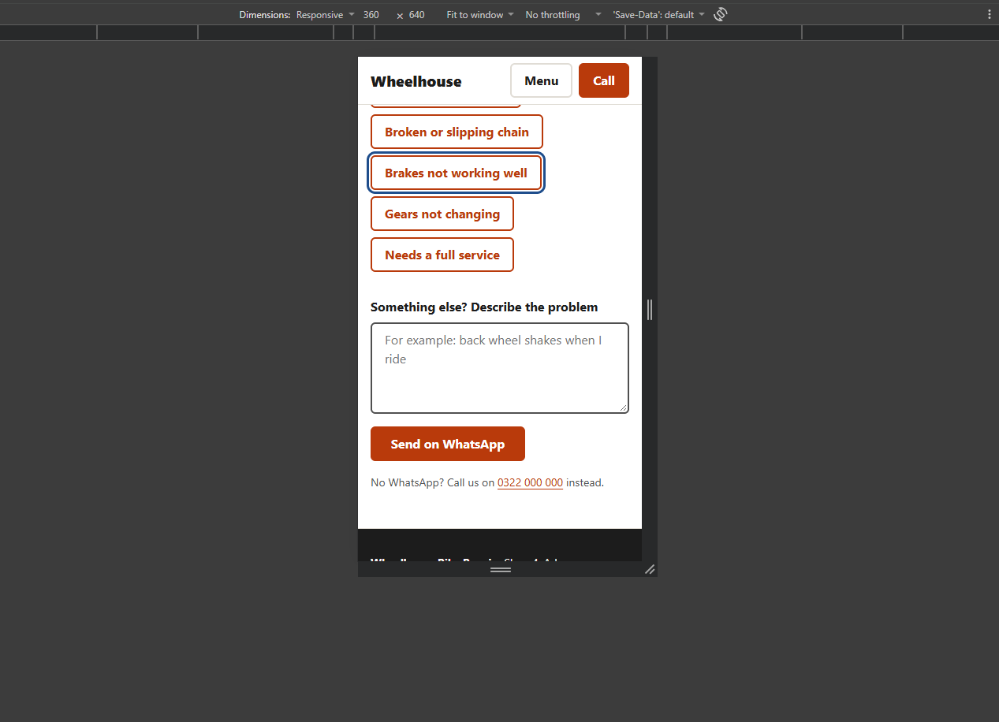 |

### Fix 2: the menu stayed open after choosing a link

**Emmanuel's finding:** 2.4.11 Focus Not Obscured (Minimum). After choosing a link in "Menu", the dropdown stayed open over the section. Escape did nothing, and Tab moved focus onto controls hidden behind it.

**Reproduced:** I opened "Menu", chose "Questions", and pressed Tab. The open menu sat on top of the first question. Escape didn't close it.

**Cause:** The menu is a native `
` element. It only closes when you click its summary again. It has no built-in "close when a link is chosen" and no Escape key behaviour, so it was doing exactly what `
` does.

**What changed** (commit `02cbad8`): I added a small `js/script.js` with three listeners on the menu:
- **choosing a link** closes the menu
- **Escape** closes it and puts focus back on "Menu", so keyboard users don't get lost
- **focus leaving the menu** (tabbing past the last link) closes it

**Why this fixes the cause:** The behaviour `
` was missing is now added on top, and nothing else changes. If the script fails to load, the menu still opens and closes by clicking "Menu", like before.

**Verified:** Choosing a link, pressing Escape and tabbing out all close the menu. After Escape, focus returns to "Menu".

| Before | After |
|---|---|
| 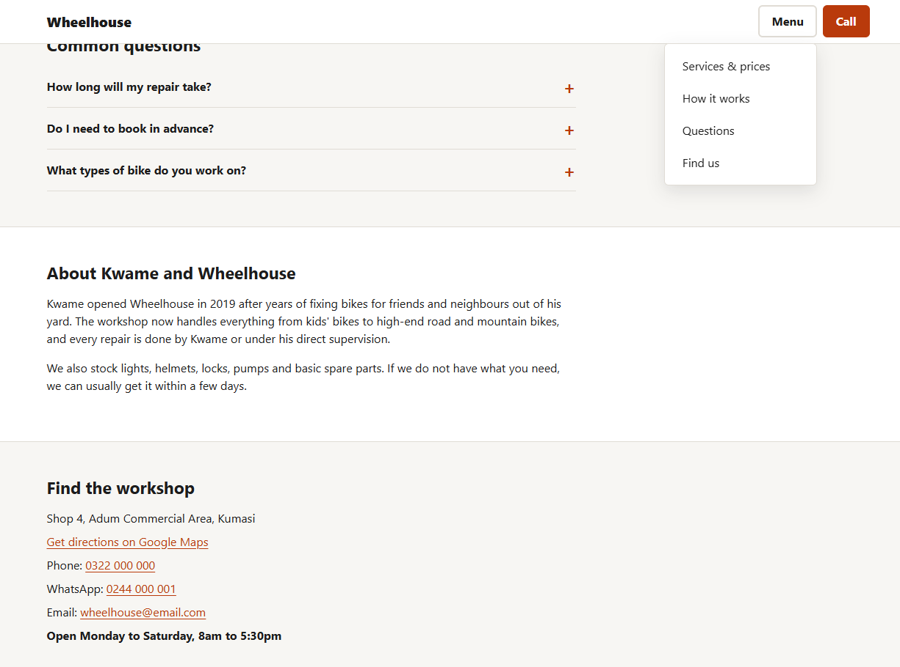 | 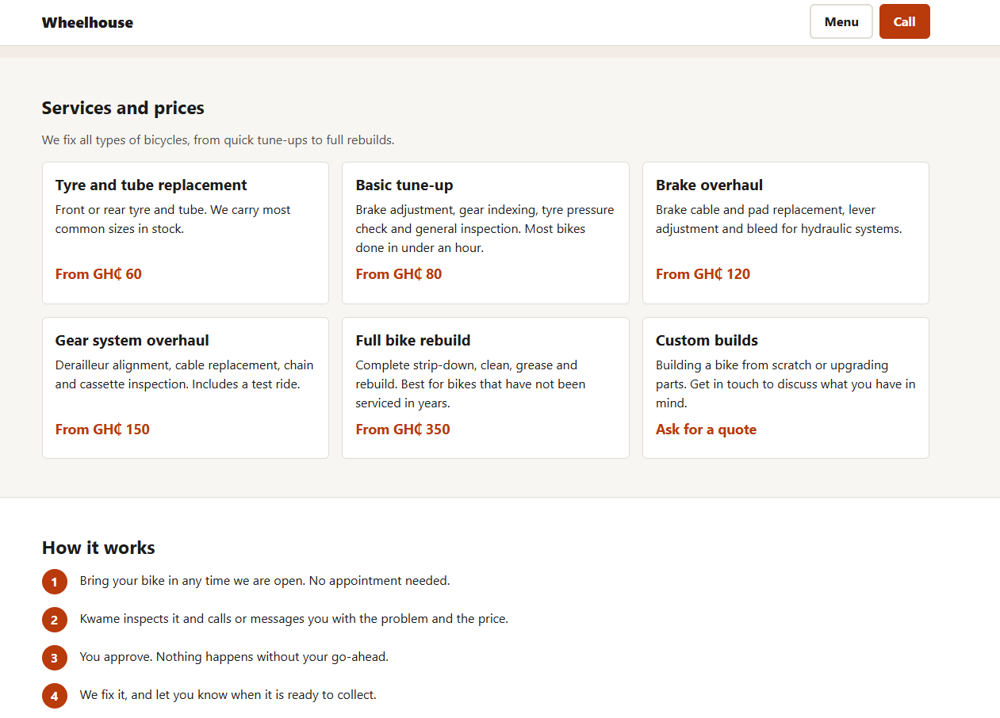 |

### Fix 3: the focus ring was too faint on the dark footer

**Emmanuel's finding:** 2.4.7 Focus Visible and 1.4.11 Non-text Contrast. The dark blue focus ring (`#1f4e8c`) on the dark footer (`#1c1c1c`) measured 2.05:1, below the 3:1 minimum.

**Reproduced:** Tabbing onto the footer phone number, the ring almost disappeared. I confirmed 2.05:1 in the WebAIM Contrast Checker.

**Cause:** I used one focus colour for the whole site and chose it for the light backgrounds, where it passes at 7:1 or better. I never checked it against the one dark area, the footer.

**What changed** (commit `d56d6a3`):
- Added a second focus colour for dark backgrounds, `--color-focus-on-dark: #f7f6f3` (the page's own off-white).
- Applied it only inside the footer: `.site-footer :focus-visible { outline-color: var(--color-focus-on-dark); }`

**Why this fixes the cause:** Each background now gets a focus colour that was checked against it. The light sections keep the blue ring that already passed.

**Verified:** The footer ring is now clearly visible. `#f7f6f3` on `#1c1c1c` measures **15.76:1**, well above 3:1. I reused the same light ring later on the dark hero.

| Before | After |
|---|---|
| 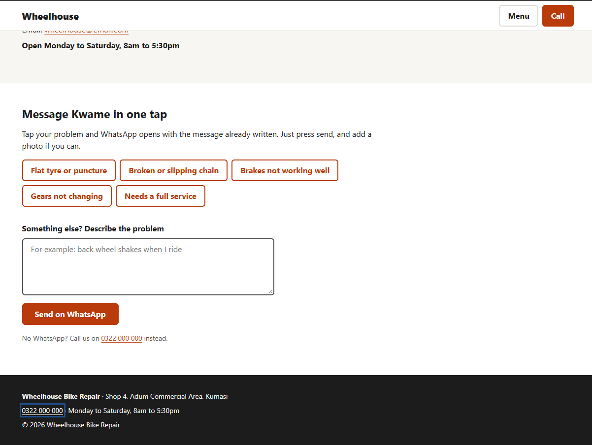 | 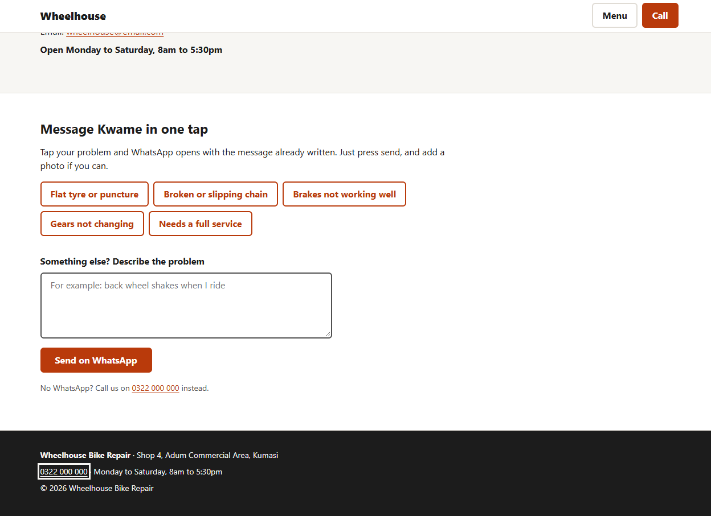 |

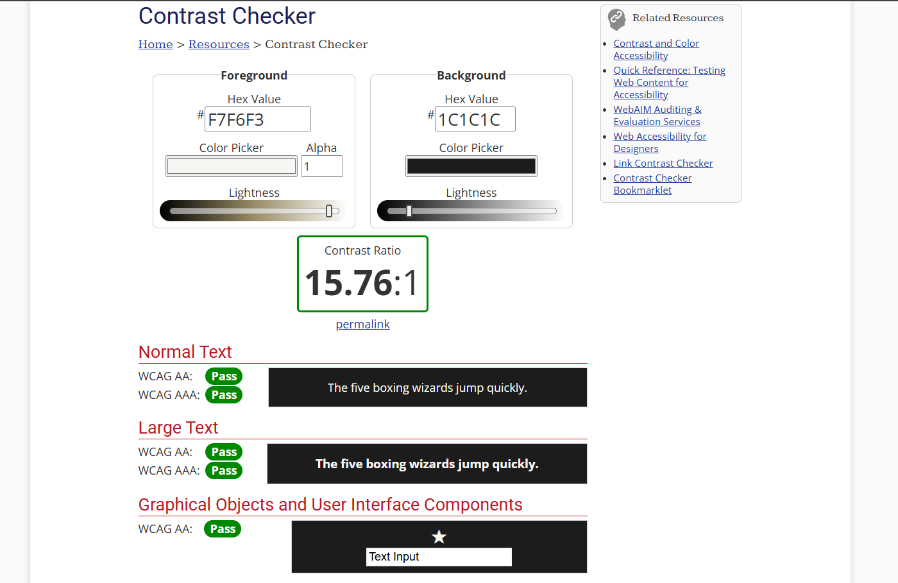

### Fix 4: at 400% zoom, the menu cut off "Find us"

**Emmanuel's finding:** 1.4.10 Reflow. At 400% zoom on a laptop window (320 × 200), the open menu pushed "Find us" off the bottom of the screen, and scrolling only moved the page behind it.

**Reproduced:** At 400% zoom, I opened "Menu" and could only see the first two links.

**Cause:** Two things together. At 400% zoom the page area is only about 200px tall, and the sticky header took up half of it. The menu panel sits inside that sticky header, so scrolling the page never moved it, and the panel had no scrolling of its own.

**What changed** (commit `7611f60`):
- The menu panel now has a maximum height of the screen minus the header (`max-height: calc(100vh - var(--header-height) - var(--space-3))`) and scrolls inside itself (`overflow-y: auto`).
- On very short screens, 480px tall or less (`@media (max-height: 30rem)`), the header stops being sticky and scrolls away with the page, so it no longer covers half the screen.

**Why this fixes the cause:** The menu can never be taller than the space it has, and any extra links scroll inside it. The header only gives up being sticky where it was causing harm. A phone held upright (over 600px tall) keeps the sticky header and its Call button.

**Verified:** At 400% zoom, the menu shows a scrollbar and "Find us" can be reached. The header scrolls away on short screens and stays sticky at 100%.

| Before | After |
|---|---|
| 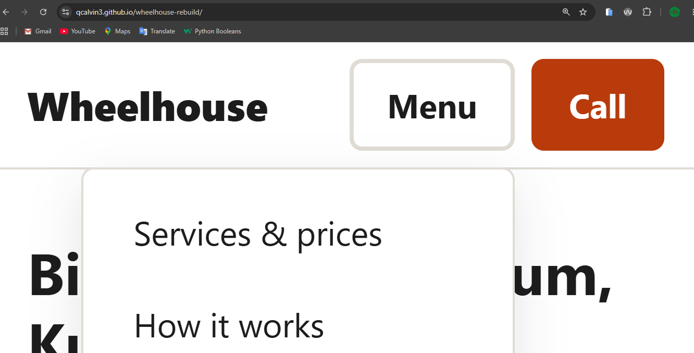 | 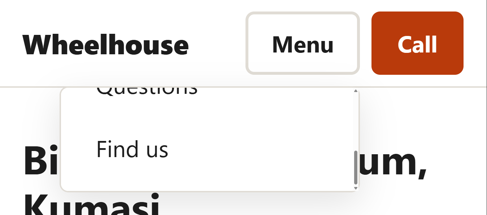 |

## 2. Issues I found myself

These come from my trainer's review of the first lab and from my own testing.

### My trainer's review

> "You noted in your diagnosis that the site needed images, but your rebuild didn't have any."
> "On desktop, the page felt like a stretched version of the mobile view... the menu could have shown the links directly instead of using the pop-up."

#### Photos on the service cards (commit `759efd8`)

My own diagnosis said images would help, and then I didn't add any. Someone who doesn't know what a "basic tune-up" is had to read the whole description. Each service card now has a photo of that job, so people can recognise a service at a glance. The text stays, because the photo helps people understand faster, it doesn't replace the explanation.

- **Shown on top, read second:** the photo comes after the heading in the HTML, and CSS (`order: -1`) moves it to the top. Sighted users see the picture first; screen reader users hear "Brake overhaul" first instead of a photo description.
- **Light on mobile data:** every photo is compressed WebP, between 15 and 54 KB, with `loading="lazy"` and `width` and `height` set so the page doesn't jump while photos load.
- **Short alt text** describing what each photo shows.

| Before | After |
|---|---|
| 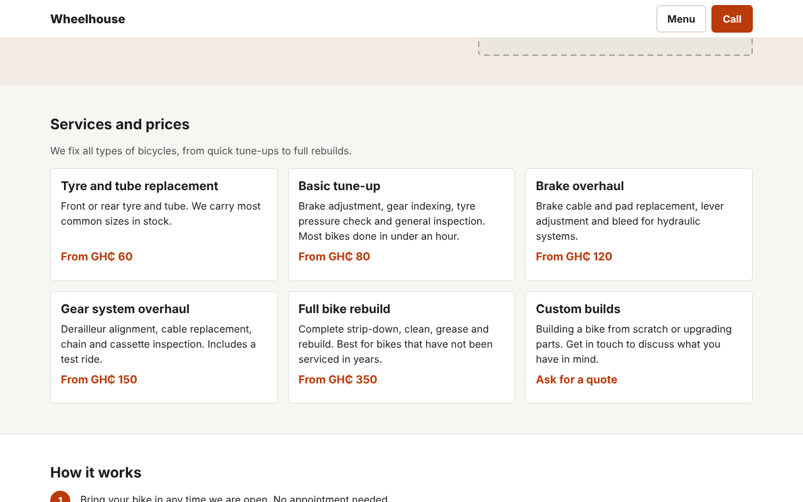 | 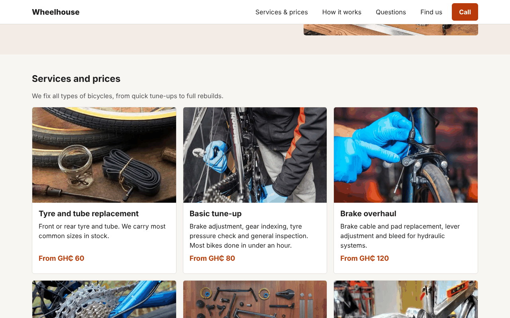 |

#### Icons in "Find the workshop" (commit `dea08d7`)

Each contact line (address, directions, phone, WhatsApp, email, hours) has a small outline icon, so people can spot the phone number or WhatsApp at a glance. The icons come from Tabler Icons (MIT licence). They have `aria-hidden="true"` and `focusable="false"`, because the words "Phone:" and "Email:" already say what each line is. Their styling sits in one `.icon` CSS rule instead of being repeated on every icon.

#### Menu links shown directly on desktop (commit `4dc6b7f`)

From tablet width up (768px), the four links sit in the header and the Menu button disappears. On phones, the pop-up works as before.

- A media query in CSS hides the Menu button once the menu is open on wide screens, and a few lines in `script.js` keep it open there (`window.matchMedia('(min-width: 48rem)')`).
- **Without JavaScript,** the Menu button stays, so the links are never lost.
- At 400% zoom the page counts as narrow, so it gets the pop-up, which keeps Fix 4 working.

| Before | After |
|---|---|
| 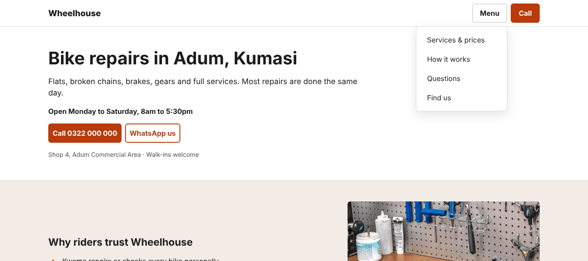 | 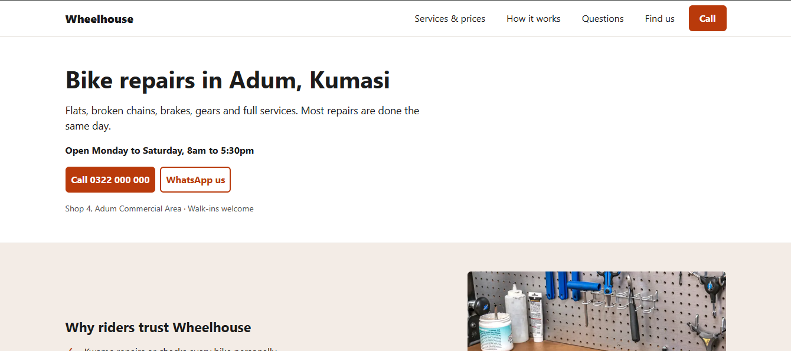 |

#### Using the desktop width (commits `28a9874` and `79f3510`)

Every section was one narrow column with the right half of the screen empty. From laptop width (1024px) up:

- **Hero:** a photo behind the text. The text sits on the dark left side and the photo shows on the right.
- **How it works:** the 4 steps as cards in a row, read left to right.
- **Common questions:** heading on the left, questions on the right.
- **About:** the story on the left, and the "we also stock..." sentence turned into an "Also in stock" checklist on the right, which is easier to scan.
- **Find the workshop:** details in two columns.
- **Message Kwame:** quick buttons on the left, message box on the right.

Each section keeps its own band and background, so they still read as separate sections. Phones get the same stacked layout as before.

**Hero contrast:** WAVE can't measure contrast for text on a photo, so I checked it myself. A dark layer (`rgb(28 28 28 / 0.72)`) covers the photo behind the text. Even over a pure white pixel, the result is about `#5b5b5b`, and white text on that is **6.7:1**, above the 4.5:1 minimum. On laptops, the layer only fades out to the right of the text, so the text is always on the dark part. The hero also uses the light focus ring from Fix 3. Phones download a 23 KB version of the photo; only wider screens load the 55 KB one.

| Before | After |
|---|---|
| 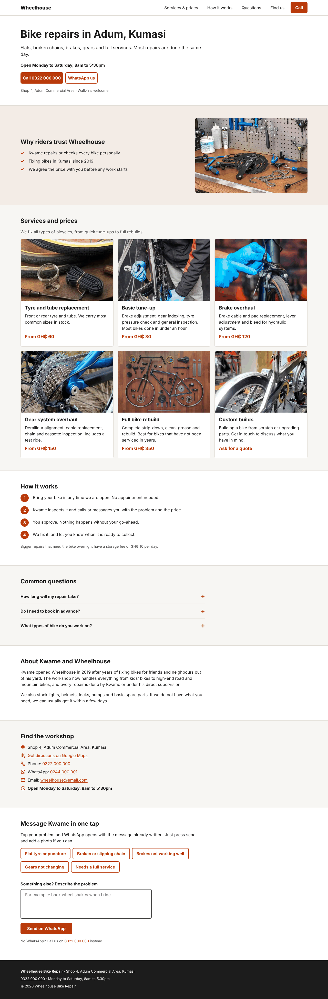 | 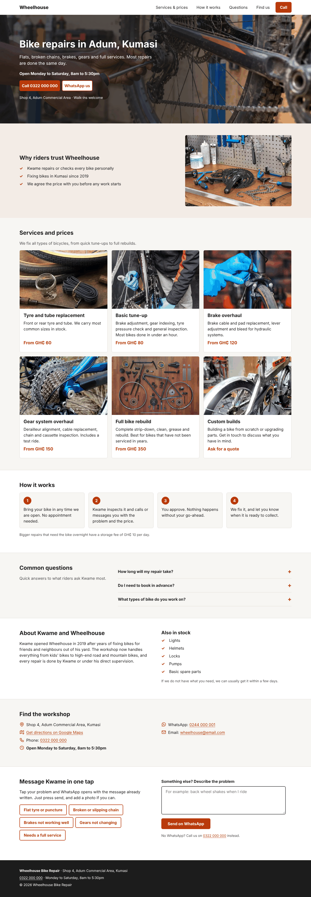 |

### Honest photos

The trainer said real photos would build the trust Kwame wants. I don't have real photos of his shop, so I made these choices so the site doesn't mislead his customers:

- **No stranger presented as Kwame.** I found a good photo of a local mechanic, but the trust section says "Kwame repairs or checks every bike personally". Next to that, anyone would assume the man in the photo is Kwame. I used a close-up of tools on a workbench instead, and the alt text describes only what's in it.
- **No full workshop shown as his.** A wide shot of a whole shop says "this is Wheelhouse". A customer who visits Shop 4 in Adum and finds a different place would feel misled. Close-ups of repairs don't claim to be any particular place.
- **The hero is an AI-generated placeholder.** The original image had a made-up "Wheelhouse Bike Repair" sign in it. I cropped the sign out, so the photo doesn't pretend to be Kwame's real shop.
- **The other photos are placeholders found through Google Images,** and I haven't confirmed their licences. Before the site goes live for Kwame, they should be replaced with his own photos or with licensed ones.

## 3. What I tried and undid

**Merging sections side by side.** I first put "Find the workshop" and "Message Kwame" into one shared band, side by side (commit `c0858e5`). On laptops it filled the space, but the two sections lost their separate backgrounds and stopped reading as two things. That goes against proximity: things that sit together look like they belong together. I reverted it (commit `2b11e0e`) and instead used the width **inside** each section, keeping their own bands.

## 4. Where I disagree with the tools

WAVE gave 8 alerts. Alerts are things to check, not failures, and I checked them:

- **6 "Possible heading":** WAVE flags short bold text, like the opening hours and the FAQ questions, in case it should be a heading. They aren't section titles, so they correctly aren't headings.
- **2 "Redundant link":** the header "Call" and the hero "Call" both go to the same number. This is deliberate. The header one stays on screen as you scroll; the hero one is the main call to action.

I also don't treat WAVE's "0 contrast errors" as covering the hero, because WAVE can't check text over a photo. That's why I worked out the hero contrast by hand.

## 5. Further improvement: a text message (SMS) option

**Who it's for:** Every way to reach Kwame needed either a voice call or WhatsApp, and WhatsApp needs mobile data. That left out:
- riders on a basic phone, or out of data, which is common in Kumasi
- **Deaf and hard-of-hearing riders,** who can't use the Call button and may have no data

Neither audit considered them. Both assumed every customer can call or use WhatsApp.

**What I built** (commit `287e9ad`):
- **Find the workshop** has a new line: "Text (SMS): 0244 000 001", with an icon.
- **Message Kwame** has a second button, **"Send as a text (SMS)"**, beside "Send on WhatsApp". It takes what the rider typed and opens their messaging app with Kwame's number and the message already filled in.
- **The note under the form** now reads: "No WhatsApp or no mobile data? Text us on 0244 000 001 from any phone, or call 0322 000 000."

**Decisions I can explain:**
- **0244, not 0322:** 0322 is a Kumasi landline, which can't receive texts. 0244 is the mobile number Kwame already uses for WhatsApp.
- **It works without JavaScript.** The SMS button needs the script to copy the message, so it stays hidden (`hidden` attribute) until the script shows it. If the script fails, the plain "Text us" links still open the SMS app on any phone.
- **Same checks as WhatsApp:** an empty message shows the browser's "Please fill out this field" warning and goes nowhere.
- **The link format** is the standard one (RFC 5724): `sms:+233244000001?body=...`.
- **No new styles.** It reuses the secondary button style from the hero's "WhatsApp us".

**Verified on a real iPhone:** I typed "Back wheel shakes" on the live site and tapped "Send as a text (SMS)". Messages opened as a "Text Message · SMS" to +233 24 400 0001 with "Back wheel shakes" already in the box.

| Before | After |
|---|---|
| 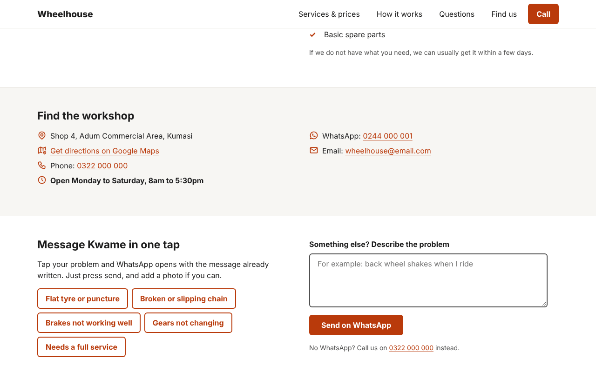 | 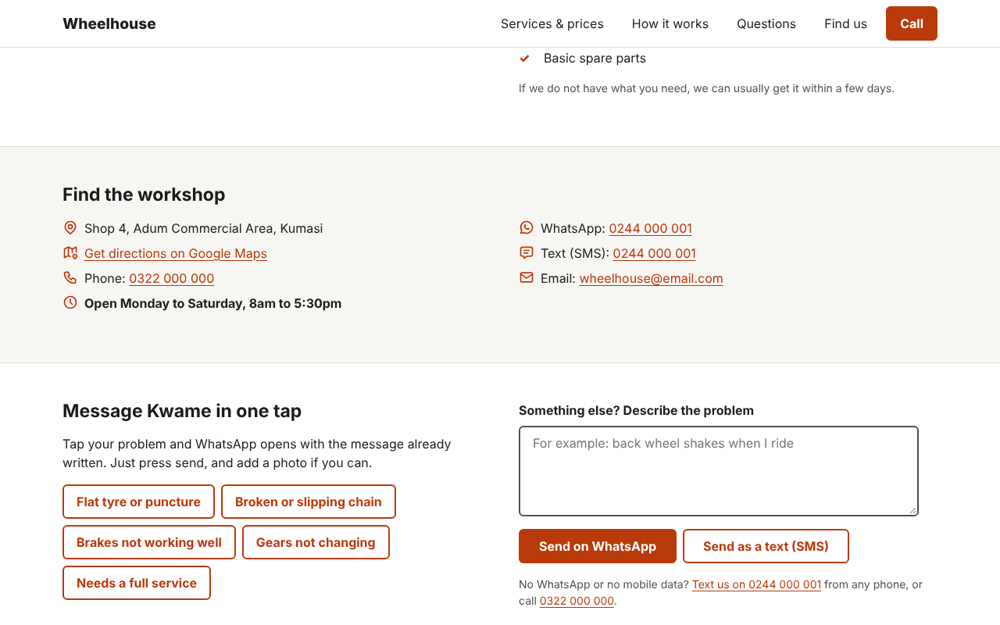 |

| On the site (iPhone) | Messages app opened |
|---|---|
| 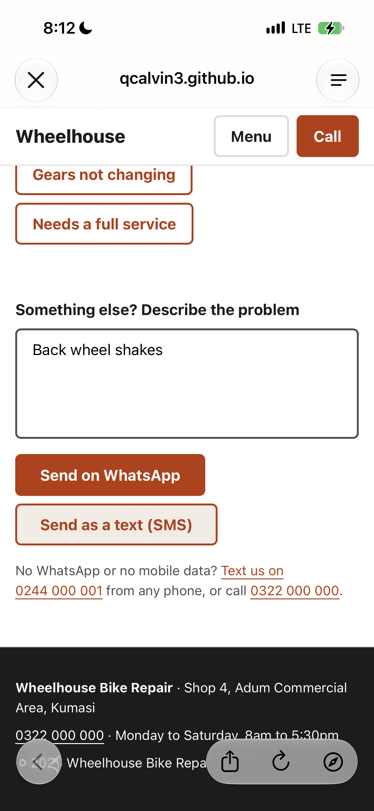 | 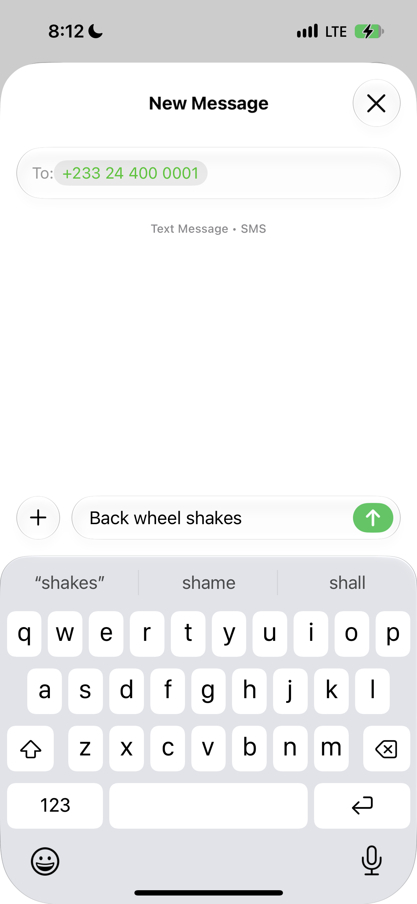 |

## 6. Final checks

Run on the live site after all the changes:

| Check | Performance | Accessibility | Best practices | SEO |
|---|---|---|---|---|
| Lighthouse, mobile | 97 | 100 | 100 | 100 |
| Lighthouse, desktop | 100 | 100 | 100 | 100 |

**WAVE:** 0 errors, 0 contrast errors, 8 alerts (explained in section 4), AIM score 9.8 / 10.

Mobile performance stayed at 97 even with eight photos, because they're compressed WebP, lazy-loaded below the first screen, and phones get the small hero.

Screenshots: [evidence/final-checks](evidence/final-checks/)

### What I didn't test

- **NVDA, TalkBack and VoiceOver on iPhone:** I didn't repeat screen reader testing after the changes.
- **SMS on Android:** I only tested on an iPhone.
- **Real users:** I didn't test with a Deaf rider, a rider on a basic phone, or anyone using voice control.
- **Windows High Contrast mode** (forced colours).

## 7. Main commits

| Commit | Change |
|---|---|
| `f0ed512` | Fix 1: scroll padding so the sticky header never hides focus |
| `02cbad8` | Fix 2: close the menu after a link, on Escape, or when focus leaves |
| `d56d6a3` | Fix 3: light focus ring on the dark footer |
| `7611f60` | Fix 4: menu scrolls, header unsticks on very short screens |
| `759efd8` | Photos on service cards, placeholder replaced |
| `dea08d7` | Icons in Find the workshop |
| `4dc6b7f` | Menu links shown in the header on tablets and up |
| `c0858e5` and `2b11e0e` | Side-by-side sections tried, then reverted |
| `28a9874` | Hero background photo with a dark layer |
| `79f3510` | Desktop width used inside each section |
| `287e9ad` | Further improvement: text message (SMS) option |
| `0270cd8` and `fae50ad` | Fixes from the professional hygiene check |
